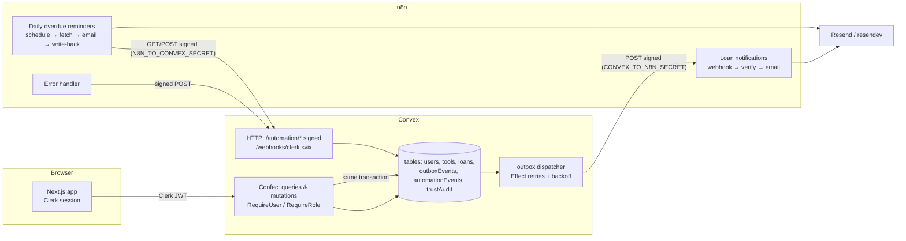

# LendLoop

**Borrow the drill. Skip the hardware store.** LendLoop is a tool-lending board for one neighborhood. Neighbors list tools, request them for a date range, and the owner approves, declines and marks them returned. Two n8n workflows handle email: loan notifications and daily overdue reminders.

Built with Next.js 16 (App Router, Cache Components), Clerk, Convex through [Confect](https://confect.dev) (Effect 4), n8n and TypeScript.

- [Quick start](#quick-start)
- [Environment variables](#environment-variables)
- [Architecture](#architecture)
- [n8n integration](#n8n-integration)
- [Security and data minimization](#security-and-data-minimization)
- [Testing](#testing)
- [Project layout](#project-layout)
- [Trade-offs and what's not done](#trade-offs-and-whats-not-done)
- Also: [PRODUCTION.md](docs/PRODUCTION.md) · [HEALTHCARE.md](docs/HEALTHCARE.md) · [DESIGN.md](docs/DESIGN.md)

## Features

| Who            | Can                                                                                                                                                                                                                                                                                                                                                            |
| -------------- | -------------------------------------------------------------------------------------------------------------------------------------------------------------------------------------------------------------------------------------------------------------------------------------------------------------------------------------------------------------- |
| Visitor        | See the tagline and a read-only list of tools (**name and category only**), then sign in                                                                                                                                                                                                                                                                       |
| Signed-in user | Browse all tools with availability, a category filter and a "Trusted lenders only" filter; list tools (name, category, condition, description, up to 3 photos); request a tool for a date range; see **My listings**, **My requests** and **Incoming requests**; approve or decline requests for their own tools; mark loans returned; see a per-loan timeline |
| Admin          | Everything above, plus **/admin**: every loan (filter by status, overdue badges), remove any listing, grant or revoke **Trusted Lender** (audited), and automation health with a "retry failed" button                                                                                                                                                         |

All of these rules are enforced in Convex functions. The UI only hides what you can't do. Loan rules:

- Start dates run from today to 60 days ahead, and a loan lasts 1–14 days.
- A borrower can have one pending request per tool.
- A tool can't be borrowed by its owner.
- Requests that overlap an approved loan are rejected.
- Approving a request auto-declines any overlapping pending requests.
- A listing can't be removed while it's on loan.

## Quick start

Prerequisites: [Bun](https://bun.sh) ≥ 1.3, Docker (with Compose v2).

```bash
bun install

# 1. Convex: creates a dev deployment and writes CONVEX_DEPLOYMENT/NEXT_PUBLIC_CONVEX_URL to .env.local.
#    (Without a Convex account, CONVEX_AGENT_MODE=anonymous runs a local backend.)
bunx convex dev --once

# 2. Clerk: keyless dev keys written to .env.local (or paste keys from the Clerk dashboard).
bunx clerk@latest init --accountless --framework next --pm bun --no-skills
```

**3. Create the Clerk JWT template named `convex`.** Convex validates this token. You can create it in the dashboard (JWT templates → Convex) or by API:

```bash
source .env.local
curl -s https://api.clerk.com/v1/jwt_templates \
  -H "Authorization: Bearer $CLERK_SECRET_KEY" -H 'content-type: application/json' \
  -d '{"name":"convex","lifetime":60,"claims":{"aud":"convex","email":"{{user.primary_email_address}}","email_verified":"{{user.email_verified}}","given_name":"{{user.first_name}}"}}'
```

**4. Shared secrets and Convex env.** Each direction has its own secret:

```bash
cp .env.docker.example .env.docker
# fill CONVEX_TO_N8N_SECRET, N8N_TO_CONVEX_SECRET and N8N_ENCRYPTION_KEY with: openssl rand -hex 32

bunx convex env set CLERK_JWT_ISSUER_DOMAIN https://<your-instance>.clerk.accounts.dev
bunx convex env set ADMIN_EMAILS you@example.com           # verified emails that become admin
bunx convex env set APP_TZ UTC
bunx convex env set N8N_NOTIFY_WEBHOOK_URL http://localhost:5678/webhook/lendloop-notify
bunx convex env set CONVEX_TO_N8N_SECRET "$(grep ^CONVEX_TO_N8N_SECRET= .env.docker | cut -d= -f2)"
bunx convex env set N8N_TO_CONVEX_SECRET "$(grep ^N8N_TO_CONVEX_SECRET= .env.docker | cut -d= -f2)"
```

**5. n8n and the local mail catcher:**

```bash
docker compose up -d
bun run n8n:setup        # imports the "Resend API" credential from RESEND_API_KEY, imports and publishes workflows
```

**6. Demo data and the app:**

```bash
bun run seed             # 4 neighbors, 8 tools, loans in every state including 2 overdue (idempotent)
bun run dev              # next dev + convex dev + confect dev
```

| URL                   | What                                                 |
| --------------------- | ---------------------------------------------------- |
| http://localhost:3000 | LendLoop                                             |
| http://localhost:3099 | resendev inbox: every email n8n sends                |
| http://localhost:5678 | n8n editor (create the owner account on first visit) |

Run the overdue workflow on demand with `docker compose exec -e N8N_RUNNERS_BROKER_PORT=5681 n8n n8n execute --id=LendLoopOverdue1`, or the **Run now** trigger in the editor.

**Cloud Convex + local n8n.** A cloud deployment can't reach `localhost`. Run `docker compose --profile tunnel up -d`, read the `trycloudflare.com` URL from `docker compose logs tunnel`, and set `N8N_NOTIFY_WEBHOOK_URL` to `<that URL>/webhook/lendloop-notify`. Also set `CONVEX_SITE_URL_FROM_DOCKER` to your `https://<deployment>.convex.site` before `docker compose up`.

**Clerk webhook (optional locally).** Users are provisioned from the verified JWT on first sign-in, so no webhook is needed to start. To sync profile changes and anonymize deleted accounts, point a Clerk webhook (`user.created`, `user.updated`, `user.deleted`) at `https://<deployment>.convex.site/webhooks/clerk` and set `CLERK_WEBHOOK_SECRET`.

## Environment variables

| Where                             | Name                                                                                               | Purpose                                                                            |
| --------------------------------- | -------------------------------------------------------------------------------------------------- | ---------------------------------------------------------------------------------- |
| `.env.local` (Next)               | `NEXT_PUBLIC_CONVEX_URL`, `CONVEX_DEPLOYMENT`                                                      | Written by `convex dev`                                                            |
|                                   | `NEXT_PUBLIC_CLERK_PUBLISHABLE_KEY`, `CLERK_SECRET_KEY`                                            | Clerk keys                                                                         |
|                                   | `NEXT_PUBLIC_CLERK_SIGN_IN_URL` etc.                                                               | Clerk routes (see `.env.example`)                                                  |
|                                   | `NEXT_PUBLIC_APP_TZ`                                                                               | Time zone that defines "today" in the UI (default `UTC`)                           |
| Convex deployment                 | `CLERK_JWT_ISSUER_DOMAIN`                                                                          | Clerk issuer for JWT validation                                                    |
|                                   | `ADMIN_EMAILS`                                                                                     | Comma-separated. **Verified** emails that are made admin on first sign-in          |
|                                   | `APP_TZ`                                                                                           | Server-side "today" for request windows and overdue checks                         |
|                                   | `N8N_NOTIFY_WEBHOOK_URL`                                                                           | n8n notification webhook                                                           |
|                                   | `CONVEX_TO_N8N_SECRET`                                                                             | HMAC key Convex signs notifications with                                           |
|                                   | `N8N_TO_CONVEX_SECRET`                                                                             | HMAC key Convex verifies n8n calls with                                            |
|                                   | `CLERK_WEBHOOK_SECRET`                                                                             | Svix secret for `/webhooks/clerk` (optional)                                       |
| `.env.docker` (n8n container)     | `CONVEX_TO_N8N_SECRET`, `N8N_TO_CONVEX_SECRET`                                                     | Same values as in Convex                                                           |
|                                   | `N8N_ENCRYPTION_KEY`                                                                               | Encrypts n8n's stored credentials                                                  |
| compose (non-secret, overridable) | `CONVEX_SITE_URL_FROM_DOCKER`, `RESEND_BASE_URL`, `EMAIL_FROM`, `APP_URL`, `APP_TZ`, `N8N_VERSION` | Defaults suit local dev                                                            |
| shell, at setup time              | `RESEND_API_KEY`                                                                                   | Goes into the n8n **credential** "Resend API" (Header Auth), not the container env |

## Architecture



- **Frontend.** Next.js App Router with Cache Components. Pages are static shells. Data comes from live Convex queries through `@confect/react`, so typed errors surface as values. URL state (filters, admin tab) uses nuqs. Forms use TanStack Form with Effect Schemas via Standard Schema. The form and the server share the same schemas from `shared/domain`. There's no `useEffect`. First-visit provisioning uses a cached promise plus `use()`.
- **Auth.** Clerk provides the session. `proxy.ts` only attaches it, and authorization is resource-based in Convex. The `RequireUser` middleware resolves the Clerk identity to a `users` row. `RequireRole` gates the admin group. Policies (`requireOwnTool`, `requireLoanParty`) guard each resource. Strangers get `NotFound` rather than `Forbidden`, so ids can't be probed.
- **Domain.** Pure Effect code lives in `shared/domain`: the loan state machine, date ranges, request windows, overdue and availability derivation. Nothing derived is stored. "Active" and "overdue" are computed from dates.
- **Convex → n8n (notifications).** Transactional outbox. A state-changing mutation writes an `outboxEvents` row _in the same transaction_ and schedules the dispatcher. The dispatcher signs and POSTs the event, with exponential backoff and jitter up to 6 attempts. It then marks the row `delivered` or `dead` and records the outcome on the loan's timeline. A cron re-dispatches rows whose scheduled run was lost. Admins can retry dead rows.
- **n8n → Convex (overdue reminders).** n8n owns the schedule and Convex owns the data. n8n makes a signed `GET /automation/overdue-loans` call. Convex answers with approved loans whose `endDate < today` that haven't been reminded today, including only what the email needs. After each send, n8n makes a signed `POST /automation/reminders` with `{reminderKey, status}`.

## n8n integration

Workflows live in [`n8n/workflows/`](n8n/workflows/). They're generated by `bun run n8n:build` from [`scripts/n8n/workflows.ts`](scripts/n8n/workflows.ts) and the Code-node sources in [`n8n/code/`](n8n/code/). The JavaScript gets reviewed and tested as code, not as escaped JSON strings. CI fails if the JSON drifts from its sources.

| Workflow                    | Flow                                                                                                                                                                                                                                                                                                                      |
| --------------------------- | ------------------------------------------------------------------------------------------------------------------------------------------------------------------------------------------------------------------------------------------------------------------------------------------------------------------------- |
| **Loan notifications**      | Webhook (raw body) → **Verify signature** (HMAC over `t.POST.path.rawBody`, 5-min window, `timingSafeEqual`) → IF valid → Build email → **Send email** (HTTP → Resend, `Idempotency-Key: eventId`, 3 tries) → `200`. A bad signature gets `401`. If the send fails, it returns `502`, so the Convex outbox retries later. |
| **Daily overdue reminders** | Schedule `0 9 * * *` (or **Run now**) → Sign request → **Fetch overdue loans** (signed GET, 3 tries) → Split → **Send reminder** (`Idempotency-Key: reminderKey`, 3 tries, error output) → sign `sent` / `failed` → **Record result** (signed POST, 3 tries)                                                              |
| **Error handler**           | Error Trigger → sign `{executionId, workflow, node, message}` → POST `/automation/errors`. Both workflows above set it as their `errorWorkflow`.                                                                                                                                                                          |

**Signing.** The header is `x-lendloop-signature: t=<unix>,v1=<hex HMAC-SHA256>`, Stripe-style. The MAC covers `t.METHOD.path.body`, so a signature can't be replayed against another body, path or method. A 5-minute tolerance bounds replays. Each direction uses its own secret. Convex's side ([`shared/integration/signature.ts`](shared/integration/signature.ts)) uses WebCrypto via Effect's `Mac` and a constant-time verify. Rejections return a bare `401` and log the reason server-side.

**Idempotency.** Write-backs are keyed: `reminder:<loanId>:<date>:<status>` and `error:<executionId>`. `automationEvents.idempotencyKey` is checked before insert inside the mutation, which is transactional, so a retried write-back returns `{"duplicate": true}` and changes nothing. Emails carry an `Idempotency-Key`, so retries and outbox redrives don't double-send with Resend. Convex also leaves a loan out of the overdue list once its reminder for today is recorded.

**No secrets in the export.** Code nodes read `$env.CONVEX_TO_N8N_SECRET` / `$env.N8N_TO_CONVEX_SECRET`, which come from `.env.docker`. The Resend key is an n8n Header Auth credential, referenced by id and imported from the shell by `n8n:setup`. A grep for the secret values over the repo is part of the release checklist in [PRODUCTION.md](docs/PRODUCTION.md).

## Security and data minimization

- **Least data per audience.**
  - Visitors get `{name, category}` from a dedicated query: no ids, owners or photos.
  - Signed-in users see an owner's **first name and Trusted badge** only.
  - The other party's **email appears only to the two parties, and only while a loan is approved**.
  - Admin loan views show first names, not emails.
- **Minimal automation payloads.** n8n receives `{eventId, type, recipient {email, firstName}, tool {name}, loan {dates, status}}`: only what one email needs, and no ids of other users. Overdue reminders go to the borrower only. n8n keeps **no successful executions** (`EXECUTIONS_DATA_SAVE_ON_SUCCESS=none`) and prunes failed ones after 7 days, so recipient emails don't accumulate in n8n.
- **Authorization in one place.** Every Convex function runs behind `RequireUser`, and admin functions also run behind `RequireRole`. Ownership and party checks run per resource. The tests in [`confect/rbac.test.ts`](confect/rbac.test.ts) call the real functions as different identities.
- **Admin bootstrap** only accepts emails from `ADMIN_EMAILS` that Clerk reports as **verified**, so signing up with an unverified copy of an admin email doesn't grant admin. Trusted Lender changes write an append-only `trustAudit` row recording who changed it and when.
- **Account deletion** (Clerk `user.deleted`) anonymizes the user: the name and email are scrubbed. Loan history stays intact for the other party, and their contact details are never shown.
- **Input validation.** Every argument, table and HTTP body is an Effect Schema. Photos are checked on the server against stored file metadata: jpeg/png/webp, ≤ 5 MB, at most 3.
- **Abuse limits.** `@convex-dev/rate-limiter` caps borrow requests at 10 per hour and new listings at 20 per day per user.
- **Network.** Compose binds n8n and resendev to `127.0.0.1` only.

## Testing

```bash
bun run check   # oxfmt --check, oxlint (type-aware), typecheck, n8n JSON drift, vitest
```

- `shared/**`: domain rules (state machine, date ranges, request window, overdue/availability) and HMAC signing (tampering, wrong secret, stale timestamps, malformed headers, and a cross-check against `node:crypto`, which is what n8n computes).
- `scripts/n8n/codeNodes.test.ts` runs the **real n8n Code-node sources** in a VM sandbox and checks that their signatures pass the server's verifier and that their bodies decode with the server's schemas.
- `confect/rbac.test.ts` and `confect/http/automation.test.ts` run the Convex functions in `convex-test`:
  - owner-only edits, lender-only decisions, `NotFound` for strangers;
  - the admin gate and the verified-email admin rule;
  - email reveal only after approval;
  - overlap handling, outbox writes;
  - the signed automation endpoints (401s, 400s, idempotent write-backs).
- CI: [`.github/workflows/ci.yml`](.github/workflows/ci.yml) runs the same checks, plus a Confect codegen drift check.

## Project layout

```
app/                Next.js routes (thin): public landing, (app) signed-in shell, sign-in/up
components/         UI by feature: tools, loans, listings, admin, app shell; ui/ = shadcn
lib/                client helpers: env, URL params, error messages, toasts
shared/domain/      Effect Schemas + pure rules shared by UI and Convex
shared/integration/ wire formats + HMAC signing shared by Convex, scripts and tests
confect/            Convex source via Confect: *.spec.ts (API) + *.impl.ts, tables/, middleware/,
                    policies/, loans/, outbox/, http/, services/ (N8nNotifier), seed/
convex/             generated Convex entry points (do not edit)
n8n/code/           n8n Code-node JavaScript      n8n/workflows/  generated workflow JSON
scripts/            n8n build/setup, signed automation CLI, Clerk webhook simulator, dev watcher
docs/               DESIGN (decision log), PLAN, PRODUCTION, HEALTHCARE
```

## Trade-offs and what's not done

- **No browser E2E suite.** The flows were exercised manually in a browser against Clerk test users. RBAC and loan rules are covered at the function level, where they're enforced. A Playwright suite with Clerk testing tokens would be the next addition.
- **Email delivery is at-least-once** between Convex and n8n. Idempotency keys make it effectively once at Resend. resendev doesn't implement idempotency, so a manual redrive locally can show a repeat.
- **n8n runs Code nodes with `$env` access** (`N8N_BLOCK_ENV_ACCESS_IN_NODE=false`), so the signing secrets don't have to sit in the workflow JSON. n8n credentials can't feed arbitrary HMAC code in a Code node. [PRODUCTION.md](docs/PRODUCTION.md) covers hardening this.
- **Single neighborhood, single time zone** (`APP_TZ`). Multi-tenant would need a `neighborhoodId` on every row and in every policy.
